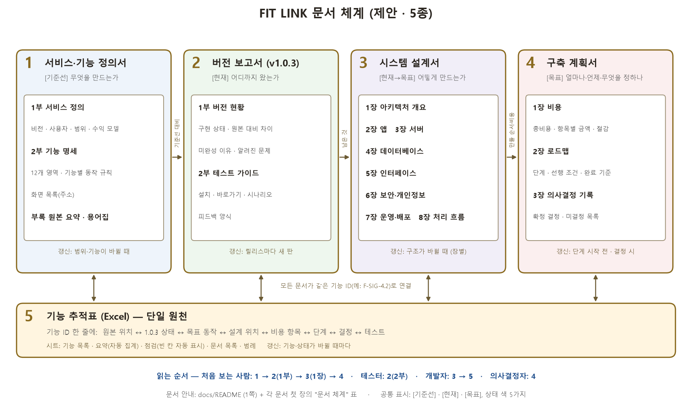

# FIT LINK 문서 안내

FIT LINK 문서는 아래 **5종**이 전부입니다. 시점·독자·갱신 주기가 같은 내용끼리 한 문서로 묶었고, 모든 문서가 같은 **기능 ID**(예: `F-SIG-4.2`)로 연결됩니다.

| 번호 | 문서 | 답하는 질문 | 시점 | 판 | 갱신 시점 |
|---|---|---|---|---|---|
| 1 | [서비스·기능 정의서](FITLINK-1_서비스기능정의서_r1.docx) | 무엇을, 왜, 어떻게 동작하도록 만드는가 | [기준선] 원본 설계 + 지향 모습 | r1 | 범위·기능이 바뀔 때 |
| 2 | [버전 보고서](FITLINK-2_버전보고서_v1.0.3.docx) | 지금 무엇이 되고 안 되며, 어떻게 시험하는가 | [현재] 1.0.3 | v1.0.3 | 릴리스마다 새 판 |
| 3 | [시스템 설계서](FITLINK-3_시스템설계서_r1.docx) | 앱·서버·DB·인터페이스·보안·운영을 어떻게 만드는가 | [현재 → 목표] | r1 | 구조가 바뀔 때 |
| 4 | [구축 계획서](FITLINK-4_구축계획서_r1.docx) | 얼마가 들고, 어떤 순서로 만들고, 무엇을 정했는가 | [목표] | r1 | 단계 시작 전 · 결정 시 |
| 5 | [기능 추적표](FITLINK-5_기능추적표_r1.xlsx) (Excel) | 기능 하나의 원본·현재·설계·비용·일정은? | 공통 | r1 | 기능·상태가 바뀔 때마다 |

## 읽는 순서

- **처음 보는 사람:** 1(1부) → 2(1부) → 3(1장) → 4
- **테스터:** 2(2부 테스트 가이드)
- **최초 개발자:** 2(1부) → 5 → 4(3장 미결정 목록)
- **개발자:** 3 → 5 → 1(2부 기능 명세)
- **의사결정자:** 4

## 공통 번호

| 표기 | 뜻 | 원천 |
|---|---|---|
| `F-영역-번호` | 기능 ID (예: `F-SIG-4.2`) — 변경·재사용 금지 | 5번 |
| `S-…` | 화면 ID | 1번 23장 |
| `T-영역-번호` | 테스트 번호 | 5번 · 2번 2부 |
| `C-n` | 비용 항목 | 4번 1장 |
| `D-nnn` / `Q-nn` | 확정 결정 / 미결정 | 4번 3장 |
| `3-4` 등 | 문서번호-장 (예: 3번 4장) | — |

## 고치는 방법

문서는 손으로 편집하지 않고 `tool/docs/`의 스크립트로 다시 만듭니다 (같은 정보는 한 곳에만).

1. 내용 수정
   - 기능 목록·상태: `tool/docs/feature_rows.py`, 목표·단계·비용 연결: `tool/docs/make_trace.py`의 `X`
   - 비용 금액: `tool/docs/cost_model.py`
   - 각 문서 본문: `tool/docs/make_*_report.py`
2. `python tool/docs/build_all.py` — 그림 → 5번 → 1~4번 순서로 생성
3. `powershell -ExecutionPolicy Bypass -File tool/docs/finalize.ps1` — Word 목차, Excel 수식 계산 (Microsoft Office 필요)
4. 5번 "점검" 시트가 모두 0인지 확인 (`"미정" 단계 기능`은 4번 Q-08·Q-09 결정 전까지 4)

필요한 것: Windows, Python 3.12+, `pip install python-docx openpyxl matplotlib`, 맑은 고딕 글꼴.

## 이전 보고서

`_보관/`에는 이 체계 이전에 만든 보고서 11건이 있습니다 (내용은 모두 5종에 흡수). 대응 관계는 `_보관/FIT_LINK_문서체계_제안서_r2.docx` 6장을 보세요.
